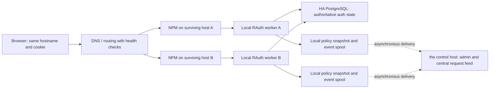

# RAuth public-access policies and active-active authentication

Date: 2026-11-01 (Europe/Vienna)
Status: Approved for implementation by the user goal on 2026-11-01; rollout gates still require verification.
Baseline: arumes31/rauth main 52cd1a2f95a2004c722f6ef572da86859100f491.
Companion: ../plans/2026-11-01-public-access-active-active.md

## 1. Intent and agreed scope

The user selected active-active RAuth and requested design and implementation planning first.

Agreed requirements:
- Public Access URL rules can allow only countries selected with checkboxes.
- A separate IP Feeds admin menu manages blocklists. Selected feeds attached to a Public Access URL block matching client IPs.
- Integrate every eligible HTTP application on every managed NPM instance with RAuth. Add Public Access entries for currently public applications; preserve existing login requirements and other NPM access controls.
- Surviving hosts support fresh logins and 2FA when the control host is down, as well as public access and existing sessions.
- Authentication supports a request reaching any healthy server through external DNS distribution. Sticky sessions are unnecessary.
- Only requests reaching RAuth are logged into the central request feed. No NPM access/error log ingestion.
- the control host remains the central administration and request-feed destination. Workers buffer events during its outage.

This is a multi-phase project, not a change limited to adding checkboxes or another container. The availability guarantee covers loss of one host while the other authentication/storage nodes can communicate. Arbitrary isolated nodes cannot safely issue globally consistent logins without quorum.

Out of scope: duplicating application backends, making sites hosted only on the control host survive its loss, collecting nginx logs, TCP/UDP stream authentication, changing existing private applications to public, choosing/subscribing to external feed providers, or purchasing DNS/load-balancer services.

## 2. Evidence and inventory

Read-only inspection identified four managed NPM instances. The control proxy
has 68 integrations (32 prior, 35 newly monitored public entries and one auth
relay); another host has nine public entries / ten aliases, another has three,
and the fourth currently has no loaded proxy entries. The exact hosts, aliases,
tailnet addresses, resource measurements and evidence paths are maintained in
the private deployment inventory. This does not prove no unmanaged NPM exists.

Relevant current code:
- internal/core/bypass.go: host/path specificity and allow-versus-login rules, persisted as JSON metadata in PostgreSQL.
- internal/handlers/auth.go: Validate checks the cookie/session first; denyOrBypass allows anonymous access on rejection. New URL restrictions cannot exist only in denyOrBypass, because a valid session would skip them.
- internal/core/authgen.go: each session validation checks account existence and credential generation in PostgreSQL.
- internal/core/redis.go, twofactor.go, handlers/auth.go and webauthn.go: sessions, pending challenges, replay markers and other transient state currently depend on Redis.
- internal/middleware/request_feed.go and core/request_feed.go: a per-process, memory-only 1,000-event ring. No distributed ingestion or durable replay exists.
- REQUEST_FEED_IP_HEADER currently changes telemetry only; it must not silently become an authorization header.
- Session cookies use CookieDomains[0]. Different registrable domains do not automatically share a browser cookie.

## 3. Approaches considered and selection

1. **Active-active application instances with shared HA security state — selected by the user.** Every NPM host runs a full RAuth worker; a surviving worker can handle login, 2FA, passkeys and validation. Redundant state removes the control host as an authentication dependency.
2. **Primary authentication with standby.** Fewer active login endpoints, but requires a switch and does not provide the requested active-active distribution.
3. **Independent workers with periodic credential/session copies — rejected.** It introduces conflicting sessions, delayed revocations and one-time-code replay during partitions.
4. **Workers still using the control host-only PostgreSQL/Redis — rejected.** Extra containers would not survive loss of their shared dependency.

Implementation decisions below are proposals for this design, not additional choices already made by the user.

## 4. Deployment architecture

Run the same versioned RAuth image on all four NPM hosts. A deployment role enables the control/admin functions on the control host and authentication/worker functions everywhere. Worker health never depends on availability of the event collector.

### HA state

Proposed baseline: PostgreSQL 18 with Patroni and a three-member etcd quorum on three independent hosts. Candidate placement is the control host, second state host, and third state host; confirm memory, persistent disks, latency, provider/failure independence and access before fixing this placement. Oracle initially remains an application worker. If a candidate fails preflight, select another already-managed independent host and record the reason.

Use one PostgreSQL write leader, synchronous replication to one of the other two data nodes, strict synchronous mode, safe promotion and fencing. Active-active describes the RAuth application layer, not unrestricted multi-primary SQL writes. Reads that authorize sessions or consume one-time state go to the current leader, never an asynchronously lagging replica.

Each host has a local HA database endpoint, for example HAProxy selecting the Patroni leader, with database TLS verification and multiple cluster addresses. Neither the database endpoint nor quorum discovery may depend solely on the control host. Three data nodes plus a three-voter quorum allow one host to fail; failover still has a detection/promotion interval. Target recovery is <=60 seconds in the tested single-host-loss scenario, not a promise of zero failed in-flight requests.

Patroni's synchronous modes trade availability for durability; deployment must prove safe leader fencing and one-host failover. Loss of quorum must reject protected authentication rather than promote conflicting writers. [Patroni replication modes](https://patroni.readthedocs.io/en/latest/replication_modes.html)

### Authoritative authentication storage

Move the security-critical Redis state into PostgreSQL-backed transactional stores:
- active sessions, expiry, rotation successors and step-up grants;
- pending password/2FA/enrollment and WebAuthn challenges;
- consumed TOTP proofs and other one-use tokens;
- invitations/redemptions and required security rate-limit counters.

Accounts, passkeys, recovery codes and auth generations already use PostgreSQL. Preserve their stable IDs and encryption. Redis may remain optional for disposable caches or local performance aids; it is not required for login correctness in HA mode. Ordinary asynchronous Redis replication can lose acknowledged writes, so it is not the authority for consumed codes or session revocations. This migration is our proposed engineering response to that limitation. [Redis replication](https://redis.io/docs/latest/operate/oss_and_stack/management/replication/)

Store opaque session/challenge lookup values as keyed digests. Keep secrets encrypted at rest using managed cluster keys; no tokens in logs. Use transactions/row locks or conditional writes for issue, rotate, revoke, consume and refresh; expiry checks occur during reads as well as cleanup. Revalidate account generation while atomically issuing a session. A network timeout after commit is an ambiguous result: retry using an idempotency key, or require a fresh challenge; never accept a consumed token a second time.

Global security throttles must work across nodes. Use bounded SQL counters for login/2FA failures and one-use operations, with local per-worker request flood limits ahead of them. No per-request sliding session-expiry write: refresh at a bounded interval and cap absolute session lifetime. Preserve existing rotation grace and binding semantics. Anonymous public requests normally use only the local policy/GeoIP/feed snapshot.

Authentication read caches cannot authorize a revoked session using stale positive data. Optimize queries and indexes first. Any later positive cache needs a separate, explicit revocation-delay contract.

### Failure behavior

| Failure | Public URLs | Login-required URLs and fresh login | Central feed |
| --- | --- | --- | --- |
| Control host lost; other two state nodes healthy | Continue with active local rules/feeds | Resume through surviving HA state after failover; fresh login + 2FA work | Local events spool; replay when the control host returns |
| One worker lost | Other configured frontends continue | Other workers recognize the same sessions/challenges | Lost worker catches up after restart |
| SQL quorum/leader unavailable | Continue anonymous access only while a complete last-good policy allows it and its freshness lease remains valid; then return 503; do not assert an identity | Deny/temporarily unavailable; never convert to public | Local spool continues |
| Feed download fails; HA policy head remains current | Keep last complete valid generation and show staleness | Existing applicable restrictions remain | Health event reports error |
| Worker restarts while control host is down | Load verified persisted snapshot/GeoIP data and verify the current HA policy head | Use surviving HA SQL endpoints | Resume persisted spool |
| No valid initial policy/GeoIP/feed data for a restricted rule | Deny affected rule; no unrestricted fallback | No policy bypass | Explain missing-data reason |
| Spool disk full | Authentication remains available | Authentication remains available | Bounded drop accounting and a visible gap; no claim of unlimited retention |

## 5. Session handoff, DNS and multiple domains

For a single hostname, a browser sends the same cookie whether its connection lands on A or B. Both nodes use the same validated key configuration and authoritative session/challenge stores. Password submission can reach A and 2FA completion B. Token rotation, logout, step-up, passkeys and recovery codes must remain correct under that distribution.

NPM normally sends /rauthvalidate to its local worker over a private Docker network. External DNS chooses a frontend, not a new unrelated authentication realm. Use a stable canonical login origin, retaining the current WebAuthn RP ID and allowed origins. Switching public IPs must not look like a client-IP/country change: every frontend derives the same original client identity through an explicitly trusted proxy chain.

For different registrable domains, add a deliberate SSO callback flow:
1. The local worker creates a short-lived login transaction bound to the exact enrolled application host, callback, browser state and intended local return URL.
2. Redirect the browser to the stable canonical RAuth login origin. An existing valid central login can complete SSO without prompting again.
3. After authentication, issue a single-use, <=60-second code bound to that transaction and destination.
4. The destination worker atomically redeems it in shared SQL, validates browser state, and sets a Secure, HttpOnly, host-only session cookie. Redirect immediately to the validated local return URL.
5. All resulting site sessions remain subject to common expiry, account-generation and logout/revocation checks.

Use an exact enrolled redirect allowlist; do not accept arbitrary return origins or wildcard callbacks. Reserve and collision-check /_rauth/callback and related integration paths per site. Scrub callback parameters from operational logs; set no-store and no-referrer. Cookies on unrelated domains are not cleared remotely by browser magic: global logout revokes the underlying server-side session family so they stop authorizing requests. Keep existing cookies readable during a controlled transition; do not silently change WebAuthn identity or force passkey re-enrollment.

Every frontend serving the canonical auth hostname exposes login/profile/callback functions locally. Route /rauthmgmt and its dynamic descendants to the control service on the control host; workers themselves reject admin mutations. Static assets may be served locally from the identical image. During a the control host outage, the central admin/feed is unavailable but auth routes remain operational. This avoids adding a new required admin hostname.

Multiple A/AAAA records are compatible with this design, but DNS-only round robin is not health-aware failover. The rollout must inspect actual provider/proxy modes and existing entitlements and select health-checked routing; do not purchase an add-on as part of document approval. Cloudflare-proxied records and DNS-only records behave differently. Preserve TLS coverage, WebSockets, upload limits and paths on every advertised frontend. [Cloudflare round-robin DNS](https://developers.cloudflare.com/dns/manage-dns-records/how-to/round-robin-dns/)

An application hostname can advertise several NPM origins only when every origin has its matching route and can reach a working application backend. Authentication HA does not replicate that application.

## 6. Public Access country and feed policies

Extend each existing rule with:
- country_mode: all (existing default) or selected;
- allowed_countries: validated ISO alpha-2 codes;
- allow_private_networks: explicit separate setting, default false for selected-country rules;
- blocked_feed_ids: stable references to zero or more active feed definitions;
- policy schema/version and audited modification metadata.

Country selection is optional. In selected mode, no checked country is invalid configuration; unknown/invalid geolocation is denied. LAN/Tailscale addresses are not countries and do not silently bypass restrictions. The optional private-network setting never overrides a matching IP-feed block. Existing rules migrate to all countries and no feeds, so deployment does not introduce unexpected country blocks.

Preserve existing exact-host/wildcard/path precedence. The single most-specific matching rule supplies the access mode and restrictions; conditions failing on that rule must not fall through to a broader public rule. A more-specific rule replaces the parent's settings, so the editor must show the effective policy and warn on a broader exemption. Rules requiring login retain that mode; the same optional restrictions may be attached to a login-required entry, but migration adds none automatically.

Evaluation order:
1. Validate trusted proxy peer and canonical target. Resolve the authoritative source IP.
2. Select the most-specific rule using existing safe path rules, including the recent whole-host semicolon/percent fixes.
3. Apply that rule's IP-feed blocks and country restrictions before cookie/session authorization. A valid login cannot override a block.
4. If public and allowed, permit anonymous access with cleared identity headers when no valid session is available. If login-required or no public rule matches, enforce the normal session, account generation, global session geofence and device binding.
5. Produce a bounded event describing the decision and rule/feed reason.

Do not relax existing ALLOWED_COUNTRIES login/session settings as a side effect of adding public-country rules.

An explicit country/feed denial returns 403 through nginx auth_request; authentication-required returns 401; successful authorization returns 2xx. Application-native 401 challenges on public sites, including Nextcloud WebDAV, must continue to reach clients. Operational errors must not become an anonymous allow. [nginx auth_request contract](https://nginx.org/en/docs/http/ngx_http_auth_request_module.html)

Public Access UI: retain the current unlock/step-up protection. Add country-mode control, searchable country checkboxes, selected count, optional private-network exception, attached-feed checkboxes and a plain-language effective-policy summary. Add a read-only URL/IP policy test. Display the matching rule, country and matched feeds without making a live protected request. All writes stay CSRF-protected and audit-logged.

## 7. IP Feeds

Add a distinct IP Feeds navigation entry with create/edit, enable/disable, refresh, version, last successful update, next refresh, accepted/rejected count and error/stale status. Show every URL rule that uses a feed. A feed is not globally applied merely because it exists: it blocks only where attached.

Initial supported format: UTF-8 text containing one IPv4/IPv6 address or CIDR per line, blank lines and # comments. No executable parsing, HTML scraping, hostname resolution inside entries or implicit CSV/JSON guessing. Normalize mapped IPv4, canonicalize prefixes and deduplicate. Provider-specific adapters are separate work if requested.

Proposed bounds: 32 configured feeds; 10 MiB decompressed response and 500,000 normalized prefixes per feed; 2 million total active prefixes per worker; 20-second fetch timeout; bounded redirects; default hourly refresh with jitter and a minimum 15-minute interval. These are configurable deployment limits that must be checked against intended sources and memory during preflight. Warn if a source exceeds them; never silently truncate an active list.

Only HTTPS feed URLs are accepted, with certificate validation. Reject plain HTTP, all other schemes and URL credentials. Reject loopback, private/link-local, metadata and internal management destinations, including at every redirect and after DNS resolution; connect only to the validated addresses. A private feed source requires an explicit, narrowly scoped administrative egress allowlist, not a generic SSRF override. Optional feed credentials use secret references and never appear in the UI's returned URL, event payload or audit diff.

Fetch once on the control service, validate into an immutable normalized generation, then publish metadata and payload checksums to workers. Workers stage the complete policy and every referenced feed version, verify the signed manifest and hashes, then atomically activate it. A download/parse failure leaves the previous generation active. Ordinary administrator attachment requires a successful first load. The managed default is the single bootstrap exception: initialization may persist its pending references, but authorization must deny those rules until the validated snapshot exists; deployment seeds it before runtime cutover. Never activate a newly referenced missing feed as an allow. Reject empty or malformed replacement datasets by default; require an explicit audited acceptance of a legitimate empty list or unusually large drop. A feed in use cannot be deleted until its references are removed through a reviewed policy change.

Workers retain active and previous complete generations on local persistent host bind mounts. They detect policy notices through an authenticated control channel and use periodic reconciliation as a fallback. Proposed healthy propagation objective is <=10 seconds; show per-worker desired/applied versions and rollout status. Changes are not reported as globally applied until all online assigned workers acknowledge them. Workers check the current signed policy-head revision/hash in HA PostgreSQL independently of the control channel every ten seconds. Builder default: a 120-second policy freshness lease, configurable only up to 300 seconds. A matching current head renews the lease even while the control host is offline. Observing a newer head immediately withdraws public-policy readiness until the complete new generation is verified and activated. If the HA head cannot be checked, a running worker may use its current generation only for the remaining lease; after expiry it returns 503 and never converts the route to public. A restart requires a fresh authoritative head check before public-policy readiness. Last-good feed-download fallback does not expire a policy lease when the authoritative head remains unchanged. This bounds revocation delay during partitions while preserving a control-host outage with surviving HA state.

Country database and trusted proxy configuration are also versioned local inputs. Feed refresh/GeoIP refresh failures never clear a denylist or country restriction. Private configuration endpoints use mutual TLS and per-node identities, with separate authorization for read-only policy fetch and event ingestion.

## 8. RAuth events and central live feed

Only observe /rauthvalidate requests reaching RAuth (plus separately retained existing security audit records). Do not mount or tail NPM logs. Requests that nginx redirects or rejects before RAuth are outside this feed. Do not synthesize a RAuth decision for them.

Extend event metadata with node_id, node_name, event_id, occurred_at, received_at, policy_version, matched_rule and reason. Preserve host/path-only URL, original source IP, country, colored action and auth response status. Distinguish country_blocked, ip_feed_blocked, login_required, authenticated, public, rate_limited and error. The status is the auth decision, not the application's final HTTP status. Feed names/IDs are included for matches; never include session cookies, credentials, request bodies or URL query/fragment data.

A bounded asynchronous queue feeds a synced local bbolt spool on each RAuth host. On 2026-11-02 (Europe/Vienna), the user selected local bbolt buffers plus the planned HA PostgreSQL cluster for central event history. SQLite is not used and no per-worker PostgreSQL server is needed. Local spool availability does not depend on the control host or HA authentication database. The central collector uses a separate event database, role and connection budget on the Dockerized HA PostgreSQL cluster. Assign durable event IDs; preserve them across retries. Batch delivery over mutually authenticated TLS uses an acknowledgment only after the collector's durable transaction commits; deduplicate by node_id + event_id. Replayed events retain original time and are visibly delayed. Live traffic and catch-up uploads have separate budgets so backlog does not starve the live stream.

The collector runs on the control host; its event database uses the planned HA PostgreSQL cluster separately from the authentication database. All database data, WAL, configuration and secrets use explicit host bind mounts; the third state host keeps them under /mnt/usb1/rauth. PostgreSQL event tables/indexes, dead tuples and WAL need physical capacity protection as well as SQL row retention. Shared-instance WAL, CPU and I/O are shared with authentication, so separate roles and connection pools alone do not provide resource isolation. Bound ingestion/catch-up rates and verify auth latency under event saturation. Local bbolt files enforce their own maximum size and retain disk headroom for copy-on-write pages. Authentication does not wait for central ingestion. Start with a 2 GiB / 24-hour local backlog cap, whichever is reached first, and seven-day central request-event retention plus a configurable storage cap. These are proposed defaults, not unlimited-lossless guarantees. Preserve existing security-audit retention separately.

Within an available spool, delivery is at-least-once with idempotent ingestion. An abrupt crash can lose the small not-yet-persisted queue/batch; disk failure, disk exhaustion or retention overflow can also create gaps. Bound the in-memory queue, count drops, retain a gap marker and expose oldest unsent age, backlog bytes and drop totals. Never let logging fill the auth database disk or block authorization indefinitely. Measure request rate and increase capacity before promising a longer outage retention window.

Retain instant SSE to the admin browser, now reading centrally persisted events. Provide node filtering, existing URL/IP/action search, pause, mobile layout and replay-gap indication. Use durable server cursors rather than per-process ring sequence alone. Keep current admin session revalidation and stream limits. Existing security-audit writes must also be audited for accidental availability coupling to the control host.

## 9. Worker enrollment and NPM coverage

A worker uses a stable enrolled ID, private service identity, known control public keys, and least-privilege DB/network credentials. Public app routes cannot call control APIs or supply trusted identity headers. Never expose Docker sockets to workers. Cluster image digest, cookie/keyring version, canonical auth origins, trusted proxy configuration and policy schema must be compatible before routing traffic.

Derive a single authoritative client IP at each NPM boundary. Honor Cloudflare visitor headers only from verified Cloudflare socket peers, handle direct LAN/Tailscale traffic correctly, and overwrite headers sent to RAuth. Explicitly review migration from the current telemetry-only header to policy/auth identity; do not conflate the two silently. Test IPv4/IPv6 and forged headers.

Inventory every enabled proxy entry and custom location, with domain aliases, auth mode, access lists, special redirects, public callback paths and backend dependencies. Register a rule for each exact public hostname/alias, not a broad wildcard accidentally exposing future sites. Use persistent NPM configuration/API/model mechanisms and supported custom includes; do not rely on edits to generated files. nginx -t must pass before reload. [NPM supported configuration hooks](https://nginxproxymanager.com/advanced-config/)

The RAuth login origin, internal validate relay and management routes need explicit self-auth exceptions to avoid recursive auth_request. Pure redirects, dead hosts and stream entries must be recorded as exceptions, not silently counted as protected HTTP applications. Do not weaken existing Basic Auth, IP access lists, application login or required RAuth rules.

Oracle's older NPM version requires compatibility testing before rollout. Upgrading NPM, if necessary, is a separate backed-up change with its own rollback. Existing authenticated access to worker host C/worker host D configurations remains a preflight dependency; reachability alone is not a host-rule audit.

## 10. Migration, rollout and rollback

1. Back up current RAuth stores/config, NPM source configuration and DNS records; prove a restore in isolation.
2. Complete host/resource/latency and source-feed preflight; select three state nodes and build an isolated HA test cluster.
3. Ship additive policy/feed schema and UI while retaining current single-node behavior.
4. Introduce SQL security-state interfaces, transactional semantics and cross-node tests behind a deployment mode. Do not mix independently writing Redis-state and SQL-state instances.
5. Migrate durable accounts/config without changing account IDs, password hashes or passkeys. For transient-state cutover, drain login mutations briefly and deliberately expire legacy sessions/pending challenges/invites/step-up grants; users log in again, and unused invites are reissued. Record this planned one-time interruption. Do not bulk-copy stale Redis authorizations into a live SQL fleet.
6. Deploy the HA state cluster and switch all enabled authentication instances together, then retain a rollback-capable binary using the same new SQL authority.
7. Enroll workers and canary on one currently public low-risk application. Test constraints and all required login flows before expanding host coverage.
8. Enable central event forwarding and validate backlog/replay.
9. Validate each application/auth origin through each intended frontend; only then configure health-aware DNS/routing.
10. Conduct controlled single-host, collector, DB-leader and network-partition drills. Roll out remaining public hosts, preserving existing protections.

After SQL becomes authoritative, rollback must not restore old Redis sessions or an old credential database that resurrects revoked access. Roll back UI/policy/worker versions only to versions compatible with the new state schema. Never use automatic fail-open NPM rules as rollback. Preserve a complete previous policy generation and per-host NPM configuration for targeted reversal.

## 11. Acceptance criteria and failure tests

- Country allowlist: selected allowed; unchecked/unknown denied; empty selection rejected; private-network opt-in explicit.
- Feed matching: IPv4/IPv6, exact addresses and CIDRs, multiple feeds, normalized mapped IPv4; feed denial wins over country allow and valid login.
- Existing rules: login-required entries remain protected; exact/wildcard/path precedence and no conditional fallthrough; semicolon/percent WebDAV regression cases pass.
- Original IP: same client country/identity through all frontends; spoofed CF/X-Real-IP/observed-IP headers cannot influence policy.
- Full login A->B: password on A, 2FA on B, validation on C. Also passkey, recovery-code, CSRF and step-up flow handoff.
- Concurrent one-time use: two nodes cannot consume the same challenge, recovery code or TOTP proof twice; repeat across leader failover and ambiguous transaction responses.
- Session rotation/logout: same cookie works on every healthy node; revocation is enforced everywhere; rotation/replacement races cannot revive old sessions.
- Cross-domain: approved destination SSO works; malicious callback/return origins, replayed codes and unbound browser state fail.
- the control host completely offline: public and protected canary applications with independent backends remain usable; fresh login and 2FA succeed after failover; admin/feed unavailable centrally only; local spool grows and replays once on return.
- Worker restart during outage loads last-good policy and resumes authentication via surviving HA state.
- SQL partition: only quorum-selected leader can accept writes; isolated workers do not open protected sites.
- Feed failure: TLS/DNS/redirect/SSRF/size/parse/empty-list tests preserve the last-good version and expose failure.
- Logging failure: collector down, duplicate delivery, disk full, queue overflow, retention expiry and process kill cannot hang auth; gaps are visible.
- DNS routing: every advertised origin has equivalent routes/TLS and a suitable readiness check; routing withdraws failed origins within a measured interval.
- Measure latency, QPS, feed memory, disk growth and recovery time with representative WebDAV/static/application traffic before production expansion.

Provisional performance objectives: local anonymous rule evaluation p95 <=5 ms excluding nginx/network; authenticated validation overhead p95 <=250 ms across chosen state nodes under observed peak plus 2x headroom. If resource/latency measurements fail these objectives, revise placement/capacity before rollout, not security semantics.

## 12. Decisions still subject to implementation preflight

These are bounded engineering choices, not unapproved feature changes:
- Final three HA state hosts after resource, access and latency checks.
- Exact container versions/digests, fencing mechanism and backup destination.
- Existing DNS provider health-routing capabilities and entitlement. A paid add-on needs a separate decision.
- Intended feed URLs and adapters, if anything beyond the documented text format is required.
- Capacity adjustment from measured event/feed volume.
- Authenticated per-host inventory on worker host C and worker host D.

Document approval selects the functional design. It does not certify these unmeasured preflight checks as passed. Implementation must report concrete changes to scope or outage guarantees before proceeding past the affected rollout gate.

## 13. Design review

An independent builder check on 2026-11-01 reported: 'nothing important left'. This checks planning completeness, not implementation correctness or production readiness. The user has selected active-active; the detailed design remains proposed for review.

## 14. Dedicated Tailscale services (user addition)

Each RAuth node gets its own persistent Tailscale sidecar/service and distinct tailnet identity (rauth-the control host, rauth-second state host, rauth-worker host D, rauth-worker host C, rauth-third state host). Inter-node policy, event and HA-state communication uses those service identities/addresses, not the Docker host's existing Tailscale identity or a public management port. State replicas/quorum members bind to their node's dedicated tailnet network namespace as appropriate. Local NPM-to-worker traffic stays on a private Docker network.

Use an official pinned Tailscale image, persistent per-node state, narrowly scoped capabilities and explicit private ingress ports. Authentication and cluster TLS remain verified on top of the tailnet; ACLs/grants must permit only the required peers and ports. Do not enable Funnel, exit-node service or subnet advertisement. Enrollment uses an external secret file and the supplied key; no key value is committed or logged. Verify key reuse/expiry and approval/tag behavior during enrollment, and remove bootstrap key mounts after successful enrollment. Never copy a Tailscale state volume between nodes. Health and outage tests include independent identities and sidecar restart.

## 15. Pi3 placement and bind-mount storage (user additions)

The user selected third state host as the third HA-node candidate and requires all its RAuth files under /mnt/usb1/rauth. Live read-only preflight verified a mounted USB ext4 filesystem at /mnt/usb1 on /dev/sda1, roughly 138 GiB free, ARM64 with four cores, about 4 GiB RAM / 2.5 GiB available, and TUN support. Storage fsync/latency and failover testing remain required. This is a three-host guarantee; do not claim three independent sites or power domains without verifying their locations.

All RAuth persistence uses explicit host bind mounts, never named or anonymous Docker volumes: PostgreSQL data/WAL, etcd data, Tailscale state, policy/feed/GeoIP snapshots, local event spools, central event storage, configuration, certificates, secrets and backups. On third state host bind paths live below /mnt/usb1/rauth. Other hosts use a documented absolute /opt/rauth tree, unless an existing appropriate host path is selected and recorded. Data paths must be mountpoint-checked before creation/start; stop if the expected filesystem is missing. The PostgreSQL image's default VOLUME destination must be covered explicitly by a bind mount, including disposable test deployments.

## User addition: default Eworx IP feed

Use https://blocklist.eworx.at/api/v1/raw as the managed built-in IP feed. Existing public rules are backfilled once, and new public rules inherit it by default; an administrator can explicitly change an individual rule selection through the step-up-protected UI. Login-required rules are not automatically changed. Keep the built-in catalog entry enabled at this fixed source; normal last-good update behavior applies.

Bootstrap and validate its snapshot before switching the runtime/NPM routes, using the packaged rauth-feed-bootstrap command while the previous feed-serving route remains available. This avoids a cold-start loop if the feed URL itself is behind RAuth. A pending/missing default snapshot must deny affected public rules rather than permit unrestricted access. Preserve explicit per-rule choices on subsequent starts. Validate using the actual HTTPS response as well as deterministic fixtures; ordinary CI tests remain independent of external feed uptime.

## Worker and state network topology

Use the dedicated Tailscale container as the network namespace owner. RAuth
workers use network_mode: service:tailscale; colocated state services use the
same namespace and bind private listeners to that node's service tailnet IP.
Policy/event APIs require mTLS identities and role authorization in addition to
least-privilege tailnet peer/port grants. No cluster or database listener is
published on the host, and cluster egress must be observed through the service
identity rather than the host's existing daemon.

For local NPM-to-worker auth, publish only the auth listener through the namespace
owner, bound to the NPM bridge's host-gateway address. Install/test host firewall
rules allowing only the NPM container source to that destination/port; reject
other container/LAN/public ingress. Keep the namespace owner off NPM's shared
network. Workers reject admin mutations. The exact gateway/source is private
inventory, not a committed live address. Rollout requires positive/negative
connectivity, listener binding, ACL/TLS, independent health and namespace
restart/recreation tests. Recreating the namespace owner must recreate/recheck
its dependent services before traffic is restored.

## User requirement: master database only for GeoIP

Country lookup must never query an external geolocation service. The master uses
its local GeoIP database as the authoritative source. Workers receive a verified,
versioned copy through signed policy distribution and perform local lookups; no
request-time call to the master or any third-party service is required. Missing,
invalid or unknown country data must retain the existing fail-closed behavior
for country-restricted rules. Database maintenance belongs only to the master.
Legacy GEO_API_HOST/GEO_API_PORT settings do not enable a lookup fallback.
